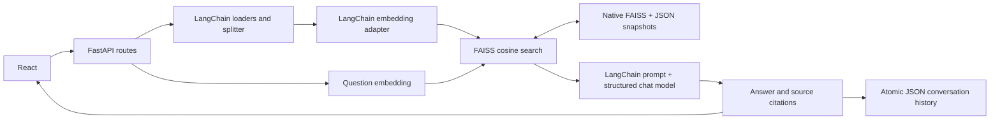

# DocMind AI

A document assistant built with **Python, FastAPI, React, LangChain, and FAISS**.
Upload PDF/TXT files, ask questions, inspect supporting excerpts, and return to saved conversations.

Start with [the step-by-step technical walkthrough](docs/STEP_BY_STEP.md). It explains the code, implementation order, engineering decisions, tradeoffs, and questions you may face in an interview.

## Requirements

- Python 3.12 (the version validated here).
- Node.js 22.12+ or 24 LTS, plus npm, **only for Vite's React development/build tooling**. There is no Node/Express application backend. The brief's requirement to use Vite requires this tooling exception.
- An API key for an OpenAI-compatible embedding endpoint and a chat endpoint supporting structured JSON-schema responses. Defaults: OpenAI `text-embedding-3-small` and `gpt-4o-mini`. Model calls may incur charges.
- Writable local disk. Run one backend process, with one worker.

## Installation

From the repository root, on Linux/macOS:

```bash
python3 -m venv .venv
.venv/bin/python -m pip install -r backend/requirements.lock.txt
cd frontend
npm ci
cd ..
cp backend/.env.example backend/.env
```

On Windows, use `.venv\Scripts\python.exe` instead of `.venv/bin/python`.

Edit `backend/.env` securely:

```dotenv
DOCMIND_API_KEY=your-provider-key
```

Never commit `.env` or paste real keys into chat. The example has empty placeholders; no keys ship with the project. Environment variables override `.env`. The app can start without credentials, but indexing and grounded generation require the relevant provider configuration. Health reports missing keys without exposing their values. A shared key is enough for the default endpoints; separate providers can use separate keys.

`requirements.lock.txt` captures the versions actually installed and tested; `requirements.txt` expresses the compatible direct dependency ranges. Use the lock file for reproducibility. The npm lock file is committed too.

## Run locally

Terminal 1, from the repository root:

```bash
cd backend
../.venv/bin/python -m uvicorn app.main:app --host 127.0.0.1 --port 8000 --reload
```

Terminal 2, from the repository root:

```bash
cd frontend
npm run dev
```

The browser app runs on port **5173**. Vite proxies `/api` to FastAPI on port **8000**. Open the development server locally in your browser. FastAPI provides interactive API documentation at `/docs` on port 8000.

Production frontend assets:

```bash
cd frontend
npm run build
```

The output is `frontend/dist/`. Production static hosting and TLS termination are deployment work; Vite's development server is not a production server. If deploying frontend separately, configure `VITE_API_BASE_URL` and the backend's allowed origins. Frontend variables are public: never put provider credentials in a `VITE_` variable.

## Configuration

All backend variables have the `DOCMIND_` prefix. See `backend/.env.example`.

| Variable | Purpose / default |
| --- | --- |
| `DOCMIND_API_KEY` | Shared provider credential; required unless both specific keys are supplied |
| `DOCMIND_LLM_API_KEY` | Optional chat credential, falls back to shared key |
| `DOCMIND_EMBEDDING_API_KEY` | Optional embedding credential, falls back to shared key |
| `DOCMIND_LLM_BASE_URL` | OpenAI-compatible chat base URL; `https://api.openai.com/v1` |
| `DOCMIND_EMBEDDING_BASE_URL` | OpenAI-compatible embedding base URL; same default |
| `DOCMIND_LLM_MODEL` | `gpt-4o-mini`; must support structured JSON-schema output |
| `DOCMIND_EMBEDDING_MODEL` | `text-embedding-3-small` |
| `DOCMIND_DATA_DIR` | `backend/data`; relative paths resolve against `backend/` |
| `DOCMIND_CORS_ORIGINS` | JSON array, defaults to localhost/127.0.0.1 port 5173 |
| `DOCMIND_MAX_UPLOAD_MB` | 10, configurable from 1 to 50 |
| `DOCMIND_MAX_EXTRACTED_CHARS` | 2,000,000 per document |
| `DOCMIND_MAX_CHUNKS_PER_DOCUMENT` | 5,000 |
| `DOCMIND_CHUNK_SIZE` / `DOCMIND_CHUNK_OVERLAP` | 1,000 / 150 characters |
| `DOCMIND_TOP_K` | Up to 5 retrieved chunks |
| `DOCMIND_MIN_SIMILARITY` | 0.25 cosine cutoff; calibrate for your corpus and model |
| `DOCMIND_REQUEST_TIMEOUT` | 45 seconds per provider request, with one retry |

HTTPS is required for model endpoints, except HTTP on loopback for local OpenAI-compatible services. For local services without authentication, use a non-secret placeholder key only if that service accepts it. Other provider protocols need an additional LangChain integration in `services/providers.py`; changing a base URL cannot convert an incompatible API.

In a managed cloud environment, allow the selected provider's hostname in network settings. Defaults require `api.openai.com`; package installation uses the Python and npm registries. A network binding that injects a key must target the same HTTPS hostname used by the configured provider. Restart the backend after changing configuration.

## Project structure

```text
DocMind-AI/
├── backend/
│   ├── app/
│   │   ├── main.py                 # App factory, lifecycle, CORS, error boundaries
│   │   ├── api/routes.py           # REST interface
│   │   ├── core/config.py          # Validated environment configuration
│   │   ├── core/errors.py          # Safe application errors
│   │   ├── schemas/models.py       # Request, response, and persistence schemas
│   │   └── services/
│   │       ├── providers.py        # Real configurable LangChain model adapters
│   │       ├── ingestion.py        # Validation, loaders, splitting
│   │       ├── storage.py          # FAISS + JSON snapshots and chat persistence
│   │       └── rag.py              # Retrieval, prompt, grounding, citations
│   ├── tests/                     # API/service/adapter integration tests
│   ├── .env.example
│   ├── requirements.txt
│   ├── requirements.lock.txt
│   └── requirements-dev.txt
├── frontend/
│   ├── src/
│   │   ├── App.jsx                # Workspace state and API orchestration
│   │   ├── components/            # Sidebar, messages, source cards, SVG icons
│   │   ├── services/api.js        # Fetch, timeouts, safe error messages
│   │   ├── main.jsx
│   │   └── styles.css
│   ├── .env.example
│   ├── vite.config.js
│   ├── package.json
│   └── package-lock.json
├── scripts/browser_smoke.py        # Optional real-browser integration test
└── docs/STEP_BY_STEP.md             # Learning guide and interview preparation
```

`backend/data/`, `.env`, `.venv`, `node_modules`, and build artifacts are ignored. No originals are retained after extraction; uploaded text is retained in indexed chunks and may also occur in saved answer excerpts.

## Architecture



Vectors are normalized; a FAISS `IndexFlatIP` performs exact cosine ranking. LangChain's FAISS wrapper reconstructs its docstore from validated JSON and retrieves the associated text. No keyword retrieval or fake model is used at runtime.

The model receives untrusted document excerpts and recent conversation context in a human message, separate from system instructions. Answers must include valid structured citation IDs and matching inline references. Weak or absent retrieval and the model's insufficient-context response produce a clear fallback. These are grounding measures, not a formal guarantee against hallucination or prompt injection. Review excerpts for consequential decisions.

## API

| Method | Path | Behavior |
| --- | --- | --- |
| GET | `/api/health` | Configuration, storage status, document/chunk counts; no secrets |
| POST | `/api/documents/upload` | Multipart `file`; 201 indexed, 200 duplicate |
| GET | `/api/documents` | List indexed documents |
| GET | `/api/documents/{id}` | Document metadata |
| DELETE | `/api/documents/{id}` | Remove document and searchable chunks; 204 |
| POST | `/api/chat` | JSON `{ "question": "...", "chat_id": null }`; answer, sources, chat ID |
| GET | `/api/chats` | Conversation summaries |
| GET | `/api/chats/{id}` | Full saved conversation |
| DELETE | `/api/chats/{id}` | Delete conversation; 204 |

Multiple files are selected in the UI and uploaded sequentially as individual bounded requests. If one fails, completed uploads remain; the UI reports where processing stopped. Files are deduplicated by content SHA-256, even if renamed. PDF text extraction includes one-based page numbers. TXT must be UTF-8. Scanned PDFs need OCR, which is outside this implementation.

Errors consistently return `{"error":{"code":"...","message":"..."}}`. Invalid inputs return 422; unsupported types 415; excessive size 413; missing resources 404; provider errors 502; missing credentials or unusable storage 503. Health is an inspectable 200 response even when configuration or storage needs attention; inspect its JSON status rather than using HTTP 200 alone as readiness proof.

## Persistence and deletion

Each update writes `data/snapshots/<server-generated-id>/index.faiss` and validated `metadata.json`. The index checksum is recorded in JSON. An atomic replacement of `current.json` activates the complete snapshot. Files and directories are fsynced on the validated Linux filesystem. Unpublished snapshots are ignored. The active and immediately preceding snapshot are retained; older snapshots are cleaned after a successful update.

There is **no pickle deserialization**. JSON schemas, ID associations, chunk counts, model identity, native index type, vector count, dimension, and binary checksum are checked on restart. Corruption or a changed embedding configuration fails closed instead of silently discarding documents. Local storage must still be trusted: checksums detect accidental corruption, not malicious replacement of both metadata and binary files, and FAISS's native loader is not a sandbox.

Deletion reconstructs a new index from surviving vectors without calling the embedding provider. Removed chunks cannot be retrieved from the active index, including after restart. This is **logical deletion, not secure erasure**: the immediately preceding snapshot and historical chat source excerpts may retain deleted text. Delete relevant conversations and securely manage backups or replace the data directory if erasure is required. Do not manually remove snapshot directories while the backend is running.

Chats use a separate atomically replaced JSON file. Failed generation does not append a partial turn. Document and chat files are separate transactions. Back up the data directory while the server is stopped. Use a fresh `DOCMIND_DATA_DIR` and re-upload when changing embedding model/endpoint; existing vectors from different models must not be mixed.

## Tests and actual validation

From the repository root:

```bash
cd backend
../.venv/bin/python -m pytest -q
cd ../frontend
npm run build
```

Optional browser test, from repository root:

```bash
.venv/bin/python -m pip install -r backend/requirements-dev.txt
# Skip this install if system Chromium is available at /usr/bin/chromium.
.venv/bin/python -m playwright install chromium
.venv/bin/python scripts/browser_smoke.py
```

`CHROMIUM_PATH` selects another installed Chromium. The browser script starts isolated servers on temporary ports, uses a temporary data directory, and stops its servers afterward. Its controlled external model doubles never become the runtime provider.

Validated in the cloud workspace:

- 44 backend tests passed, including real PDF extraction and text splitting, actual FAISS indexing/ranking, metadata and chat reload, deletion, corrupt storage and write-failure behavior, input validation, CORS, provider failure handling, and citation checks.
- A real LangChain OpenAI adapter test verified embedding requests and structured chat response parsing against simulated HTTP responses.
- Browser smoke passed: multi-file TXT/PDF upload, question/answer, citation expansion, history after refresh, new chat, deletion, empty upload rejection, and mobile navigation, with no JavaScript runtime errors.
- Vite production build passed; package dependency consistency passed.
- Runtime HTTP checks confirmed configuration-required health and that Vite's API proxy reaches FastAPI.

**Live external model calls have not been validated**: no model API credentials were available. Automated tests simulate external calls while running actual application code. To validate your provider, configure credentials, upload a known policy document, ask a question with a known answer, inspect the excerpts, then ask an unsupported question. A configured key is not proof that billing, endpoint permissions, or model capabilities work.

LangChain Community currently emits a deprecation warning. Its loaders and FAISS integration are used deliberately to meet the specified LangChain stack; all reported tests pass despite that warning.

## Scope and limitations

- A single-user local application, **not** a production enterprise multi-tenant service. No authentication, tenant separation, encryption at rest, distributed locking, or audit system. Bind locally; do not expose this app to the Internet or untrusted users.
- One worker/process only. A process-local lock serializes mutations and questions, including provider calls. Multiple workers would corrupt update ordering. Exact FAISS search and full snapshot rebuilding favor simplicity over large-scale throughput.
- Uploaded text and retrieved excerpts are sent to the configured embedding/chat providers. “Local persistence” does not mean model processing stays local. Review provider data policies before uploading sensitive documents.
- App reads and validates a bounded upload after multipart parsing. For external deployment, also set request/body limits at a trusted reverse proxy, isolate PDF parsing, and add authentication and rate limits. This version has no OCR, malware scanner, or PDF parser sandbox.
- Character chunking does not preserve every table or document layout. Follow-up retrieval includes the previous user question, not a full query-rewriting system. Similarity thresholds need evaluation on real documents. No claim of perfect grounding or adversarial prompt-injection resistance is made.
- Snapshot copying, deletion, and query docstore construction scale with library size. Index vectors are capped near 512 MB; JSON and chat history remain local files without pagination or a retention limit. Large libraries require a separate design.
- Timeouts apply per provider request, not to the entire multi-batch upload. Browser cancellation does not cancel a running backend request. Check persisted state before retrying after a timeout.
- The UI uses plain React, CSS, inline SVG, and system font fallbacks. No external fonts, UI framework, database, alternative vector store, or Node application backend is required.
